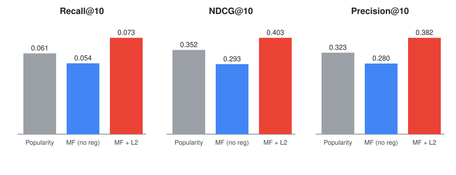

# 🎬 Movie Recommender with Matrix Factorization (BPR)

A movie recommender system built **from scratch in NumPy** using Matrix Factorization trained with **Bayesian Personalized Ranking (BPR)** on the MovieLens-1M dataset, with an analysis of how **L2 regularization** fixes over-fitting.

> Course project — CCAI 422 Recommender Systems, University of Jeddah (Summer 2026)

**[▶ Live demo](https://aiwadod.github.io/movie-recommender-bpr/)** — pick films you liked and the trained model ranks all 2,496 titles for you in the browser.

> The demo interface is an extra, **not part of the course requirements**. Its design was built with AI assistance, and poster artwork is supplied by TMDB. The recommender itself — Matrix Factorization, the BPR training loop and the evaluation — is implemented from scratch in NumPy.

---

## Highlights

- Implemented Matrix Factorization and BPR training from scratch (no recommender libraries)
- Showed that plain MF **over-fits** and is even beaten by a simple popularity baseline
- Adding **L2 regularization** raised test **NDCG@10 from 0.29 to 0.40 (+38%)** and made the model the best on every metric
- Full-ranking evaluation over all movies with Recall@10, NDCG@10, and Precision@10

## Results (MovieLens-1M, top-10)

| Model | Recall@10 | NDCG@10 | Precision@10 |
|---|---|---|---|
| Popularity (baseline) | 0.0611 | 0.3524 | 0.3229 |
| MF, no regularization | 0.0536 | 0.2928 | 0.2800 |
| **MF + L2 (ours)** | **0.0729** | **0.4031** | **0.3820** |

<p align="center">
  
</p>

## How it works

- **Model:** each user and movie gets a 32-dimensional latent vector; a user's score for a movie is their dot product.
- **Training (BPR):** for a user, a movie they liked should score higher than a random movie they did not interact with. Trained with mini-batch SGD.
- **Improvement:** an L2 penalty (λ = 0.02, chosen from {0, 0.005, 0.02, 0.05}) keeps the vectors small and stops the model from memorizing the training data.
- **Data:** ratings ≥ 4 treated as "likes", 1,000 most-active users, 10-core filtering, per-user 80/20 split → 1,000 users, 2,497 movies, 223,106 train and 55,264 test interactions.

## Project structure

```
├── notebooks/movie_recommender_bpr.ipynb   # full walkthrough with outputs
├── src/movie_recommender_bpr.py            # standalone script
└── assets/                                 # result figures
```

## Run it

```bash
pip install -r requirements.txt
# download MovieLens-1M from https://grouplens.org/datasets/movielens/1m/ and unzip it here as ml-1m/
python src/movie_recommender_bpr.py
```

## Team

Abdulelah Gomah · Muataz Fallatah · **Abdulwadod Badogaish** · Rayan Alghamdi

**My part:** the Matrix Factorization model, BPR training, and the regularization (over-fitting) improvement.

## References

- S. Rendle et al., *BPR: Bayesian Personalized Ranking from Implicit Feedback*, UAI 2009
- Y. Koren, R. Bell, C. Volinsky, *Matrix Factorization Techniques for Recommender Systems*, IEEE Computer, 2009
- F. M. Harper, J. A. Konstan, *The MovieLens Datasets*, ACM TiiS, 2015
